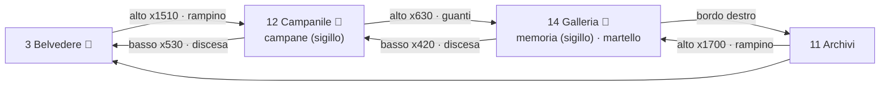

# Zona 2 — «Campanile e Orologi» (stanze 12 e 14)

Nota di progetto per la zona che segue le Cisterne. Fonti: `VERTICAL-SLICE.md` (catena delle abilità),
`design/levels/espansione-caserta.md`, `src/data/expansion.json` (edges, vertical, landmarks, cracks).
Blockout giocabile in scena: `tools/levels/zone2_design.gd` → `rooms/r12_campanile.tscn`, `rooms/r14_galleria_orologi.tscn`.

## Perché questa zona
- Le Cisterne danno, in quest'ordine, **guanti** (`wall_grip`, dopo la chiusa), **rampino** (`grapple`, Ratking)
  e **martello** (`hammer`, disegno nelle Cisterne Sepolte). La zona che usa *tutte e tre* le abilità è la
  salita **Belvedere (3) → Campanile (12) → Galleria degli Orologi (14)**:
  - 3 → 12: uscita in alto del Belvedere, **serve il rampino** (anelli del Belvedere);
  - 12 → 14: uscita in alto del Campanile, **servono i guanti**;
  - 14: la memoria `clock_memory` (7° sigillo) è murata tra `clock_wall_west` e `clock_wall_east`, **serve il martello**.
- Contiene due sigilli dei quartieri (`bells`, `clock_memory`), quindi spinge verso il Cortile (finale) e chiude
  l'anello verso gli Archivi (14 → 11 dal bordo destro; 11 → 14 dall'alto col rampino).
- Contrasto di ritmo con le Cisterne: una torre verticale (1280×2400) e una galleria lunga (3520×1080).

## Mappa e passaggi

| Passaggio | Abilità | Note |
|---|---|---|
| 3 → 12 | rampino | arrivo su una mensola sopra il varco (530, 2156) |
| 12 salita | salto + doppio salto | zig-zag sinistra/destra (+128), percorso di riferimento nei marcatori `Route` |
| 12 → 14 | guanti | tappo chiuso finché non si hanno i guanti (`need: wall_grip`) |
| 14 ovest ↔ memoria ↔ est | martello | muri pieni, stessi id e rettangoli dei JSON (salvataggi compatibili) |
| 14 → 11 | — | bordo destro (edges) |
| 11 → 14 | rampino | arrivo sul pavimento (3310, 930) |

**Backtracking**: la zona si chiude in anello (3 → 12 → 14 → 11 → 3); chi arriva senza martello vede la memoria
murata e ci torna dagli Archivi. Il Campanile si scende sempre (varco in basso verso il Belvedere).

## Segreti
| Stanza | Dove | Accesso |
|---|---|---|
| 12 | nicchia murata a sinistra (128, 1120), muro `bell_niche_wall` | martello (chiusa sopra e sotto: né rampino né guanti) |
| 12 | nido in alto a destra (1184, 256), anello (1060, 362) | rampino (o guanti sul muro destro) |
| 14 | balcone ovest (1024, 440), anello (1024, 520) | rampino |
| 14 | balcone est (2880, 440), anello (2640, 560) | rampino |

## Salvataggi (incudini)
- 12: a terra, appena entrati (1100, 2300), sempre attiva: la torre è lunga e c'è un cavaliere.
- 14: lato Archivi (3000, 980), sempre attiva: punto di ritorno per chi arriva dagli Archivi o dopo la memoria.

## Ritmo dei combattimenti (solo nemici esistenti)
| Stanza | Tratto | Nemici | Intensità |
|---|---|---|---|
| 12 | piano terra | cavaliere | alta, con incudine vicina |
| 12 | salita bassa/media | gatto, vespa, spettro | media, in aria |
| 12 | salita alta | statua (su mensola), vespa | media |
| 14 | ovest | guardia (parata), lanterniere | media |
| 14 | punte / est | vespa, duellante, guardia, cavaliere, gatto | alta, poi incudine |

## Arte
- Le immagini approvate in `design/art/cisterne-grok` sono acqua, tufo e trono di Ratking: non si adattano a una
  torre campanaria né a una galleria di orologi. Come piano medio in parallasse si usano i fondali dipinti già
  presenti nel progetto (`assets/art/areas/espansione/campanile.png`, `galleria_orologi.png`), attenuati (dim 0.7);
  la Galleria è appoggiata al pavimento (`floor_v` 0.85). Il vecchio `painted_interior` non viene creato: un solo fondale.
- Terreno in blockout (64 px, tile invisibili, disegno di `terrain.gd`): niente doppioni con tile dipinti.
- Asset da chiedere all'Art Director: tileset di pietra del campanile, kit campane/ingranaggi, quadranti d'orologio,
  muro incrinato alto (galleria), fondale grok della Galleria con orologi senza piattaforme dipinte.

## Rischi aperti
- La salita del Campanile resta una scala a zig-zag (la cura è nei nemici e nei segreti): va rivista nell'editor
  quando ci saranno i pezzi d'arte.
- Coi guanti tutti i muri sono scalabili (anche i bordi della stanza): i gate interni sono il martello e i varchi tappati.
